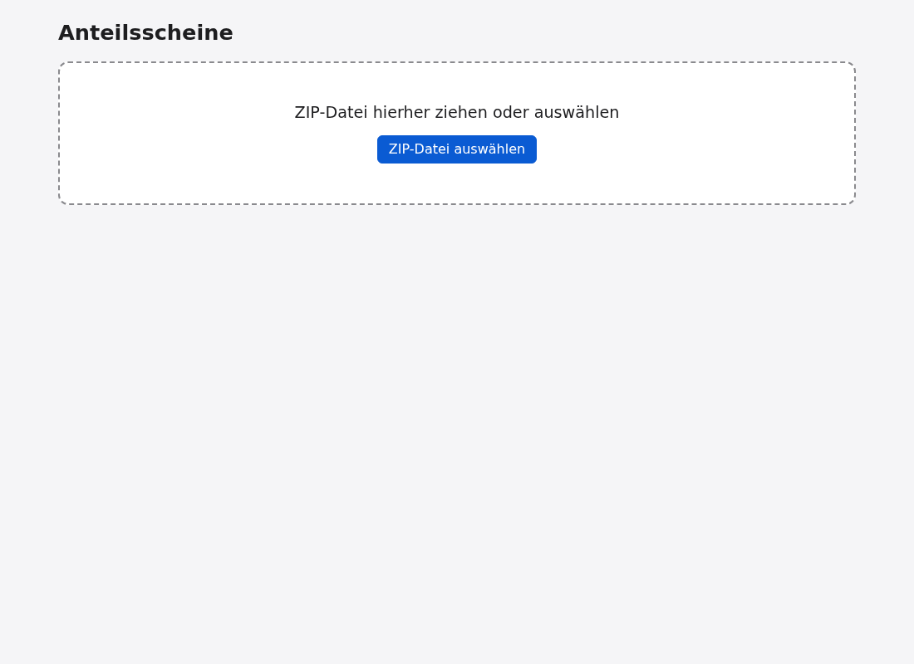
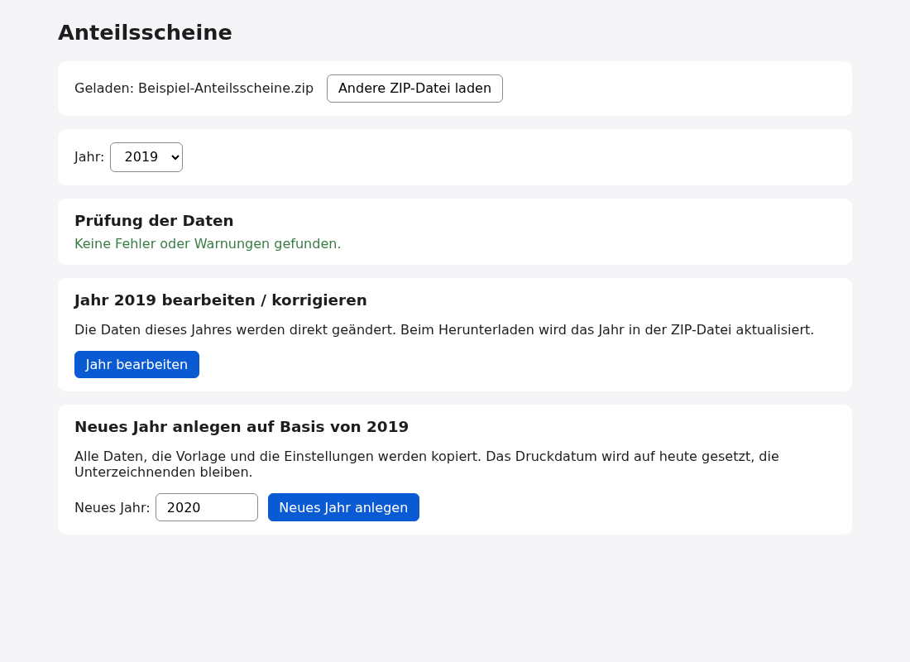
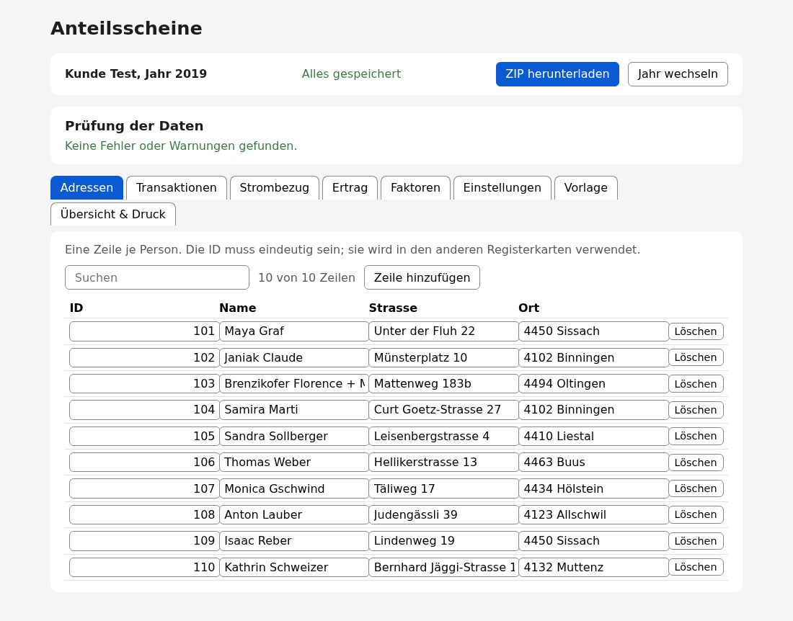
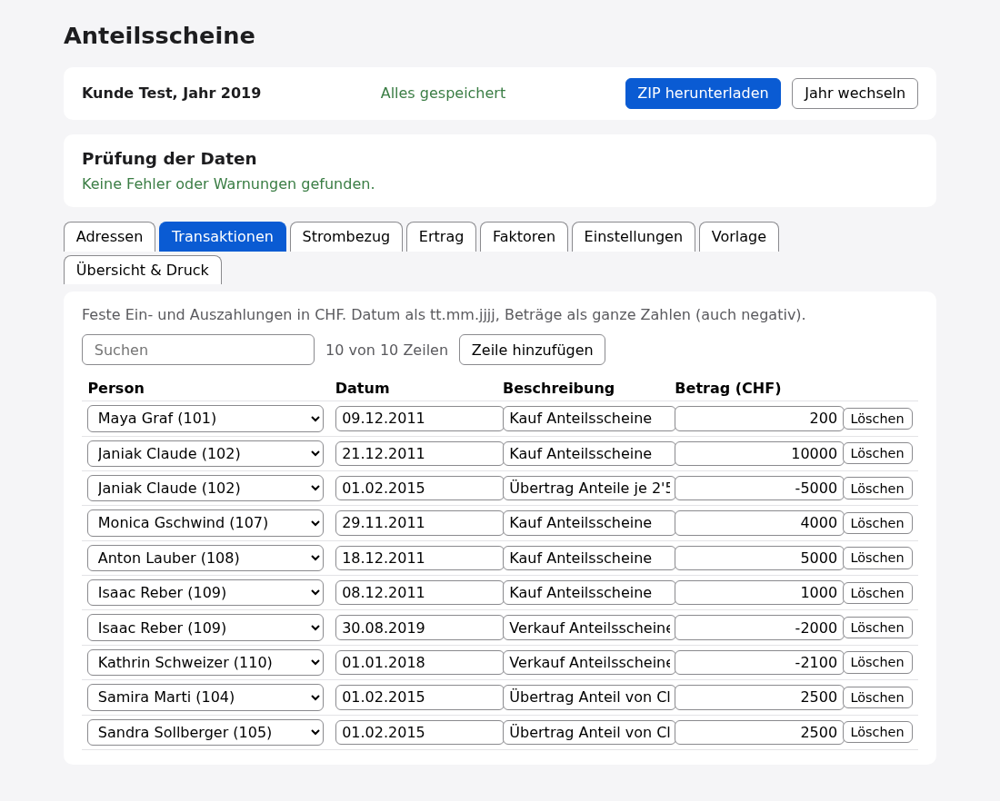
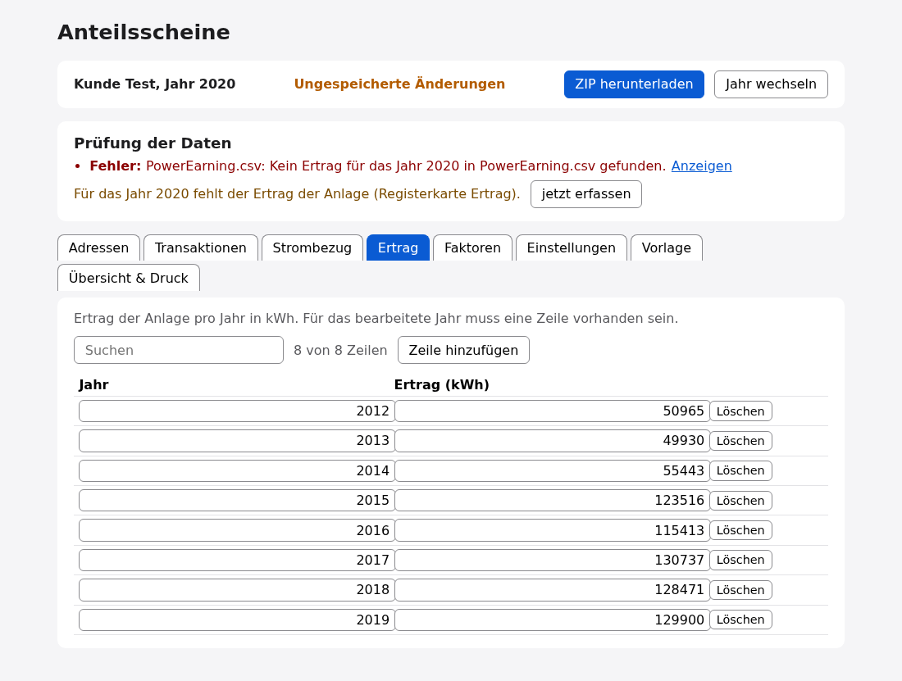
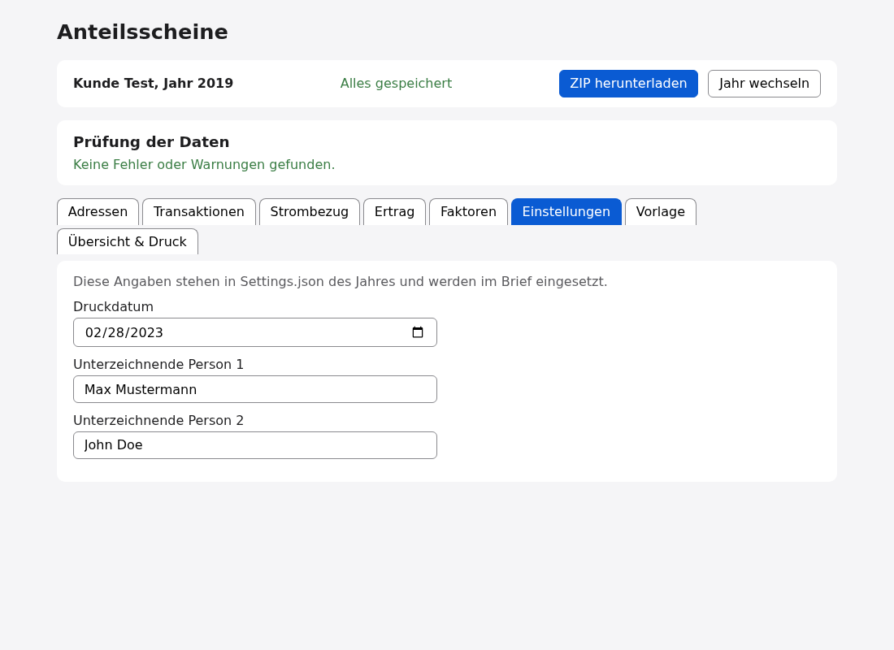
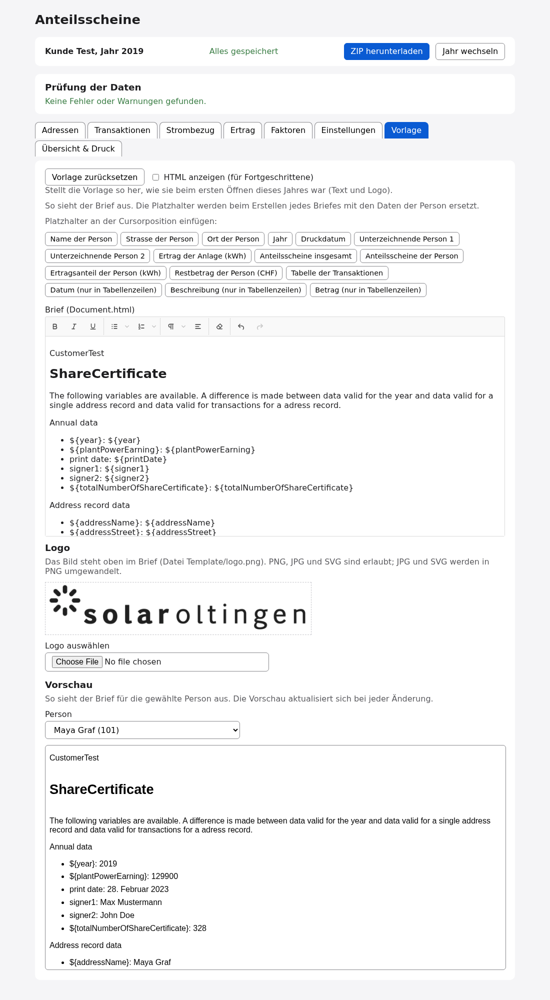
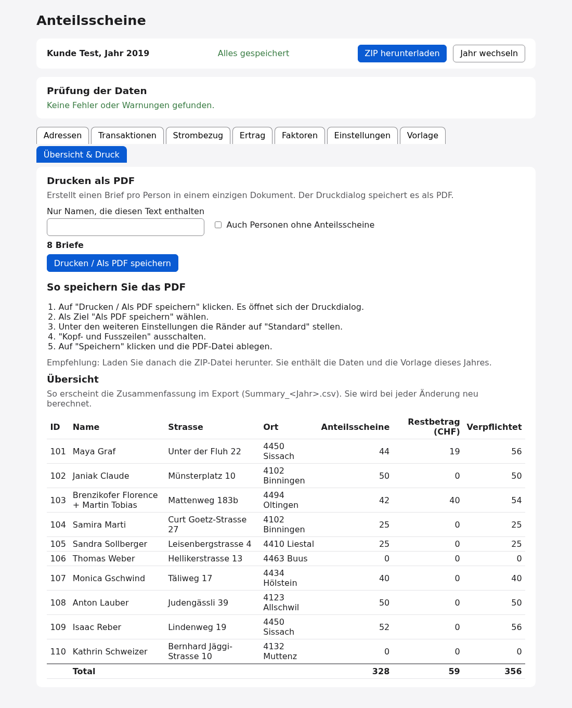
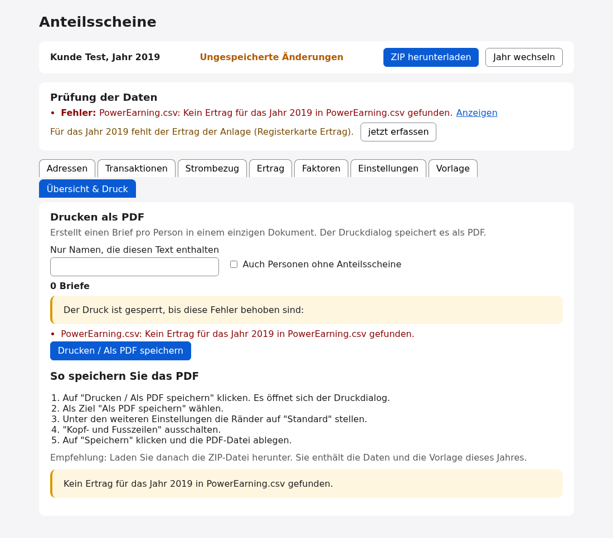

# Anteilsscheine: Benutzeranleitung

Mit diesem Programm erstellen Sie die jährlichen Sammelanteilsscheine. Sie
laden eine ZIP-Datei mit den Daten, bearbeiten sie im Browser, speichern die
ZIP-Datei wieder und drucken die Briefe als PDF.

**Ihre Daten bleiben auf Ihrem Computer.** Es wird nichts ins Internet
übertragen. Sie brauchen keine Installation.

## 1. Vorbereitung

- **Browser:** Verwenden Sie eine aktuelle Version von Chrome, Edge, Firefox
  oder Safari.
- **Programm:** Öffnen Sie die Datei `Anteilsscheine.html` mit einem Doppelklick.
  Sie öffnet sich im Browser.
- **Daten:** Sie brauchen die ZIP-Datei mit dem Ordner des Kunden, zum Beispiel
  `CustomerTest/2019/`. Zum Ausprobieren gibt es die Datei
  `Beispiel-Anteilsscheine.zip` (im Ordner `web/docs/` des Projekts).

## 2. Der Jahresablauf in Kürze

1. ZIP-Datei laden
2. Jahr wählen: bestehendes Jahr korrigieren oder neues Jahr anlegen
3. Daten prüfen und ergänzen
4. Druckdatum und Unterzeichnende eintragen
5. Brieftext und Logo bei Bedarf anpassen
6. Briefe als PDF drucken
7. ZIP-Datei herunterladen und sichern

## 3. ZIP-Datei laden

Ziehen Sie die ZIP-Datei auf die grosse Fläche oder klicken Sie auf
**ZIP-Datei auswählen**.

Nach dem Laden zeigt das Programm den Namen der Datei an. Mit
**Andere ZIP-Datei laden** wählen Sie eine andere Datei.

Haben Sie ungespeicherte Änderungen, fragt das Programm zuerst nach, ob Sie
wirklich eine andere Datei laden wollen.

## 4. Jahr wählen

Oben wählen Sie den Kunden (falls es mehrere gibt) und das Jahr. Darunter stehen
zwei Karten:

- **Jahr bearbeiten / korrigieren:** Klicken Sie auf **Jahr bearbeiten**. Die
  Änderungen gehen direkt in dieses Jahr.
- **Neues Jahr anlegen:** Geben Sie das neue Jahr ein (vorgeschlagen ist das
  nächste Jahr) und klicken Sie auf **Neues Jahr anlegen**. Alle Daten, die
  Vorlage und die Einstellungen werden kopiert. Das Druckdatum wird auf heute
  gesetzt. Die Unterzeichnenden bleiben. Ein Jahr, das schon existiert, wird
  nicht überschrieben.

## 5. Daten prüfen und ergänzen

Im Bereich **Prüfung der Daten** sehen Sie Fehler (rot) und Warnungen (gelb).
Mit **Anzeigen** springen Sie direkt zur betroffenen Stelle.

Die Registerkarten:

| Registerkarte | Was dort steht |
|---|---|
| Adressen | Eine Zeile je Person: ID, Name, Strasse, Ort. Die ID muss eindeutig sein. |
| Transaktionen | Feste Ein- und Auszahlungen in CHF. Beträge sind ganze Zahlen, auch negative. |
| Strombezug | Jährlicher Strombezug in CHF je Person. Auch künftige Jahre gehören hierher. |
| Ertrag | Ertrag der Anlage in kWh je Jahr. Für das bearbeitete Jahr muss eine Zeile vorhanden sein. |
| Faktoren | Umwandlungsfaktor je Jahr, z. B. `0.8` oder `1.0` (mit Punkt). Jedes Jahr mit Strombezug braucht einen Faktor. |

So bearbeiten Sie eine Tabelle:

- Klicken Sie in eine Zelle und tippen Sie. Die Änderung wird sofort übernommen.
  Gesichert ist sie erst, wenn Sie die ZIP-Datei herunterladen (Abschnitt 9).
- **Zeile hinzufügen** fügt eine neue Zeile am Ende an. Bei einer Adresse wird
  die nächste freie ID vorgeschlagen.
- **Löschen** entfernt eine Zeile, nach einer Rückfrage. Bei einer Adresse mit
  Transaktionen oder Strombezug erscheint vorher eine Warnung.
- Im Feld **Suchen** filtern Sie die Zeilen. Ein Klick auf eine Spaltenüberschrift
  sortiert sie. Die Reihenfolge in der Anzeige ändert nichts an den Daten.
- Datumsangaben schreiben Sie als `31.12.2026` oder kurz als `31.12.26`.
- Eine Zelle mit ungültigem Wert wird rot umrandet. Mit dem Mauszeiger sehen
  Sie, was falsch ist.

### Hinweise für ein neues Jahr

Fehlen für das neue Jahr der Ertrag oder ein Umwandlungsfaktor, zeigt das
Programm einen Hinweis mit dem Knopf **jetzt erfassen**. Damit springen Sie zur
passenden Registerkarte.

## 6. Einstellungen

In der Registerkarte **Einstellungen** tragen Sie das **Druckdatum** und die
beiden **Unterzeichnenden** ein. Die Angaben werden im Brief eingesetzt.

## 7. Vorlage anpassen (optional)

In der Registerkarte **Vorlage** ändern Sie den Brieftext wie in einem
Textprogramm: fett, kursiv, Absätze.

- **Platzhalter einfügen:** Klicken Sie an die Stelle im Text und dann auf den
  Platzhalter. Beim Drucken wird er durch die Angabe der Person ersetzt.
- **Logo:** Wählen Sie ein Bild (PNG, JPG oder SVG). Es ersetzt das Logo im Brief.
- **Vorschau:** Wählen Sie eine Person. So sieht ihr Brief aus.
- **Vorlage zurücksetzen:** Stellt den Stand wieder her, wie er beim Öffnen
  dieses Jahres war.
- **HTML anzeigen:** Nur für Fortgeschrittene. Fehlerhaftes HTML kann den Brief
  verändern.

Die wichtigsten Platzhalter:

| Platzhalter | Bedeutung |
|---|---|
| Name der Person | Name der Person |
| Strasse der Person, Ort der Person | Adresse der Person |
| Jahr | Jahr der Anteilsscheine |
| Druckdatum | Druckdatum aus den Einstellungen |
| Unterzeichnende Person 1 und 2 | Namen aus den Einstellungen |
| Anteilsscheine der Person | Anzahl der Anteilsscheine der Person |
| Restbetrag der Person (CHF) | Betrag, der noch nicht für einen Anteilsschein reicht |
| Ertragsanteil der Person (kWh) | Anteil am Ertrag der Anlage |
| Tabelle der Transaktionen | Alle Transaktionen der Person bis zu diesem Jahr |

## 8. Briefe drucken

Wechseln Sie zur Registerkarte **Übersicht & Druck**.

- **Nur Namen, die diesen Text enthalten:** Schreiben Sie einen Teil des Namens,
  um nur diese Personen zu drucken. Gross- und Kleinschreibung zählen.
- **Auch Personen ohne Anteilsscheine:** Standardmässig sind diese Personen nicht
  dabei. Setzen Sie den Haken, wenn sie einen Brief erhalten sollen.
- **8 Briefe:** Anzahl der Briefe mit den gewählten Filtern.

Klicken Sie auf **Drucken / Als PDF speichern**. Es öffnet sich der Druckdialog
Ihres Browsers. Gehen Sie dann so vor:

1. Als Ziel **Als PDF speichern** wählen.
2. Unter den weiteren Einstellungen die Ränder auf **Standard** stellen.
3. **Kopf- und Fusszeilen** ausschalten.
4. Auf **Speichern** klicken und einen Speicherort wählen.

Jeder Brief beginnt auf einer neuen Seite. Die Bezeichnungen im Druckdialog
können je nach Browser etwas anders heissen.

Der Druck ist gesperrt, solange Fehler in den Daten bestehen. Die Gründe stehen
dann über dem Knopf. Warnungen sperren den Druck nicht.

## 9. ZIP-Datei herunterladen und sichern

Klicken Sie oben rechts auf **ZIP herunterladen**. Das Programm speichert eine
Datei mit diesem Namen:

`Anteilsscheine_<Kunde>_<Jahr>_<Datum>.zip`

Die Datei enthält alle Daten, die Vorlage und die Zusammenfassung des Jahres.
Bewahren Sie sie auf. Beim nächsten Mal laden Sie genau diese Datei wieder.

Nach dem Download zeigt das Programm **Alles gespeichert**. Der Stand gilt
dann als gesichert.

**Wichtig:** Das Programm speichert Ihre Arbeit im Browser zwischen. Schliessen
Sie die Seite trotzdem nicht, ohne die ZIP-Datei herunterzuladen. Beim nächsten
Öffnen bietet das Programm die letzte Sitzung an, sofern der Browser das
unterstützt.

## 10. Häufige Fehlermeldungen

| Meldung | Bedeutung | Was Sie tun können |
|---|---|---|
| Die ZIP-Datei enthält keine Jahresordner. | Die Struktur `Customer<Name>/<Jahr>/` fehlt. | Prüfen Sie, ob die ZIP-Datei die richtigen Ordner enthält. |
| Die Datei ist keine gültige ZIP-Datei. | Die Datei ist beschädigt oder kein ZIP. | Die Datei neu erstellen oder aus der letzten Sicherung holen. |
| Die Datei X fehlt. | Eine Pflichtdatei fehlt im Jahresordner. | Die Datei aus einer früheren Sicherung in den Jahresordner legen. |
| Spalte(n) fehlen: ... | Eine Spalte fehlt in der CSV-Datei. | Die Datei mit der richtigen Spaltenüberschrift neu anlegen. |
| Die Zeile kann nicht gelesen werden. | Anführungszeichen oder Spaltenanzahl stimmen nicht. | Die Zeile in der Tabelle prüfen und korrigieren. |
| Ungültige Ganzzahl in Spalte X | Ein Betrag oder eine ID ist keine ganze Zahl. | Nur ganze Zahlen eingeben, ohne Punkt und Apostroph. |
| Ungültiges Datum in Spalte X | Das Datum ist nicht erkennbar. | Im Format `31.12.2026` oder `31.12.26` eingeben. |
| Ungültige Dezimalzahl | Der Faktor ist nicht lesbar. | Mit Punkt schreiben, z. B. `0.8`. |
| Kein Ertrag für das Jahr X gefunden. | Im Ertrag fehlt das bearbeitete Jahr. | In der Registerkarte Ertrag die Zeile für dieses Jahr erfassen. |
| Mehrere Erträge für das Jahr X gefunden. | Das Jahr steht zweimal im Ertrag. | Eine der beiden Zeilen löschen. |
| Kein passender Umwandlungsfaktor für das Jahr X gefunden. | Ein Strombezug liegt in einem Jahr ohne Faktor. | In der Registerkarte Faktoren den Faktor für dieses Jahr erfassen. |
| Mehrere Umwandlungsfaktoren für das Jahr X gefunden. | Das Jahr steht zweimal bei den Faktoren. | Eine der beiden Zeilen löschen. |
| Die Adress-ID X kommt mehrfach vor. | Zwei Personen haben dieselbe ID. | Eine der beiden IDs ändern. |
| Die Adress-ID X existiert nicht in Address.csv. | Eine Transaktion verweist auf eine unbekannte Person (Warnung). | Die Person in den Adressen erfassen oder die Zeile löschen. |
| Settings.json fehlt. | Die Einstellungen fehlen (Warnung). | Druckdatum und Unterzeichnende in den Einstellungen eintragen. |
| Die Datei ist kein gültiges JSON. | Die Einstellungen sind beschädigt. | In den Einstellungen **Mit Standardwerten ersetzen** wählen. |
| Unbekannter Platzhalter: `${...}` | Die Vorlage enthält einen Platzhalter, den es nicht gibt (Warnung). | Den Platzhalter aus der Liste einfügen oder entfernen. |
| Die Vorlage Document.html enthält keinen Bereich `<body>`. | Der Brieftext fehlt. | Vorlage zurücksetzen oder den Brieftext neu schreiben. |
| Es gibt keine Anteilsscheine mit Strombezug. | Ohne Anteilsscheine kann der Ertragsanteil nicht berechnet werden. | Transaktionen und Strombezug der Personen prüfen. |
| Das Jahr muss eine vierstellige Zahl sein. | Die Jahreszahl beim neuen Jahr ist falsch. | Eine Zahl wie `2027` eingeben. |
| Das Jahr X existiert bereits. | Das Zieljahr gibt es schon. | Ein anderes Jahr wählen. |
| ... ist nicht UTF-8 kodiert ... | Die Datei hat eine ältere Zeichenkodierung (Warnung). | Keine Massnahme nötig. Beim Speichern wird UTF-8 geschrieben. |

Wenn eine Meldung hier nicht vorkommt oder Sie nicht weiterkommen, wenden Sie
sich an die Person, die das Programm betreut. Halten Sie den Text der Meldung
bereit.
